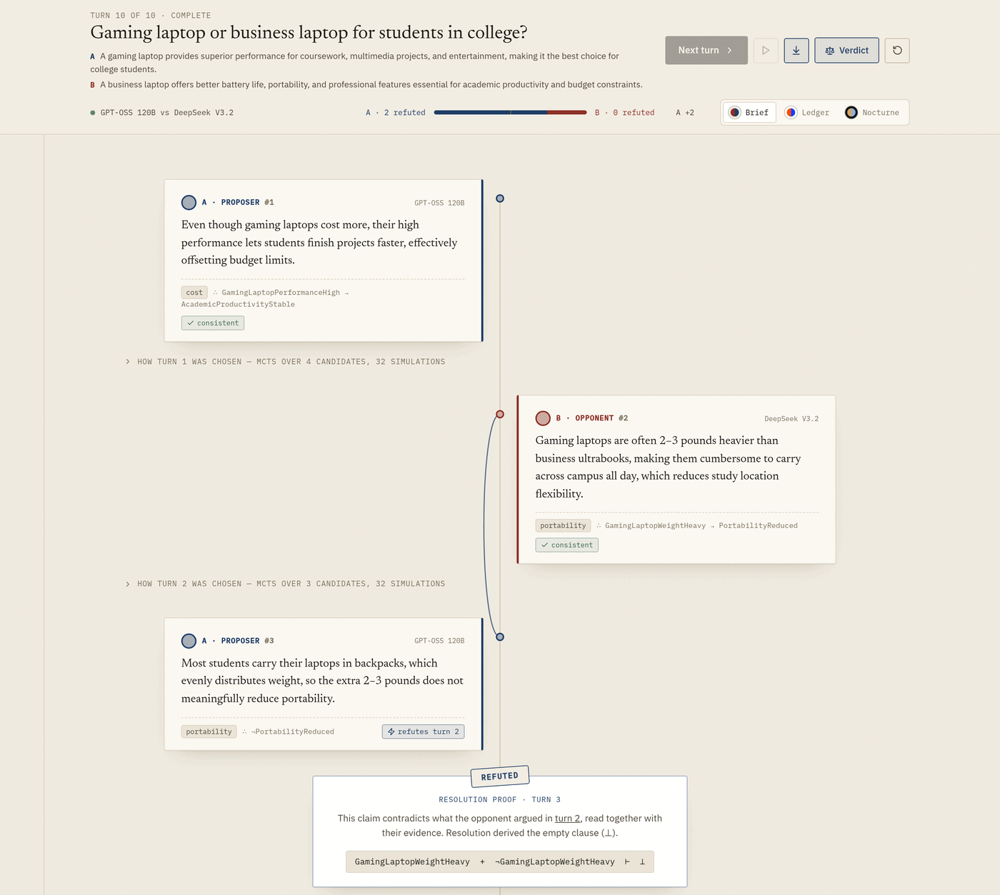
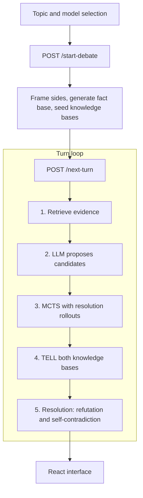
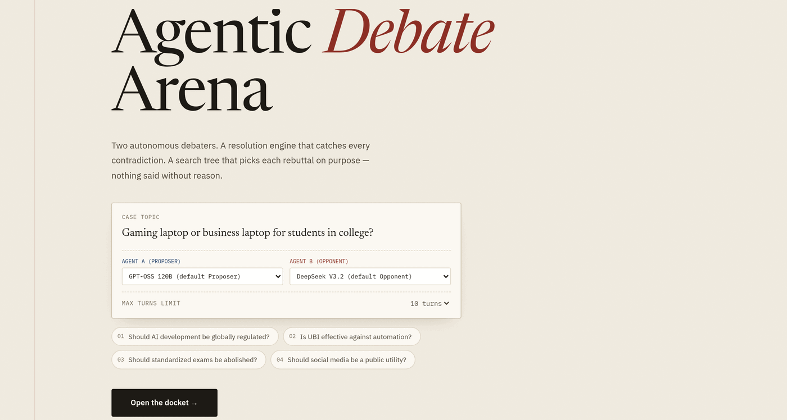
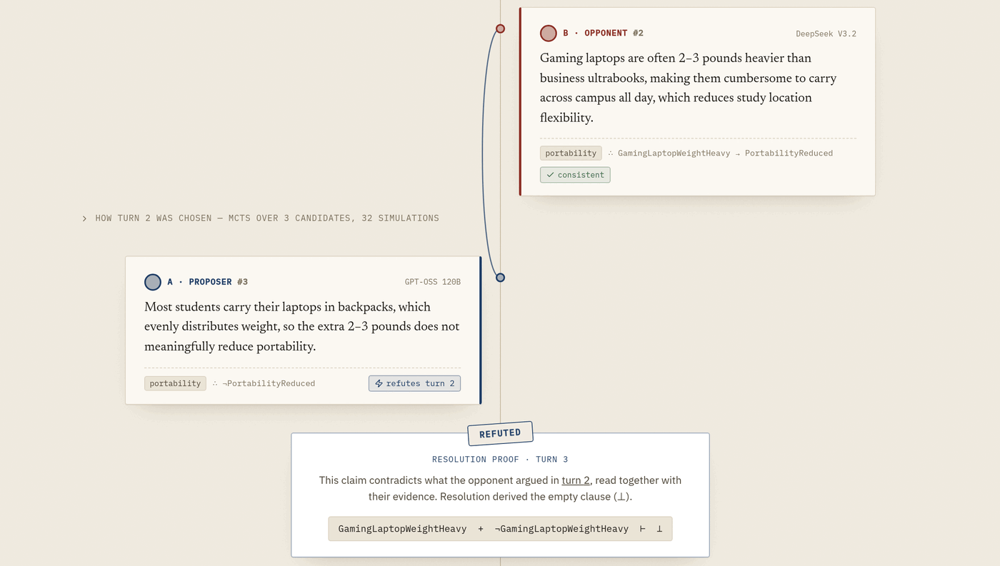
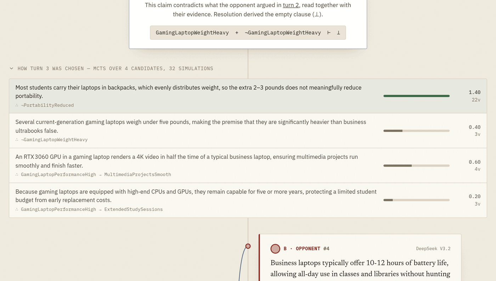
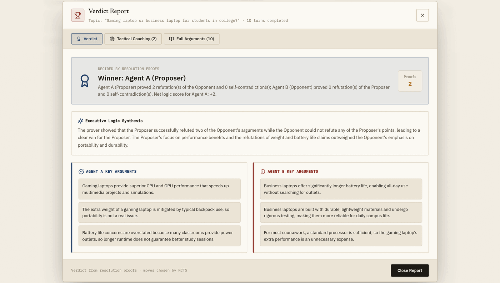

# Agentic Debate Arena

A neuro-symbolic debate system in which two AI agents argue opposite sides of a topic. Language models propose the arguments; Monte Carlo Tree Search (MCTS) decides which argument is spoken, and propositional resolution proves every refutation and self-contradiction. The verdict comes from those proofs, not from a language model.

Built for the Foundations of Artificial Intelligence course: knowledge-based agents (Unit I), informed search (Unit II), adversarial search (Unit III) and propositional logic (Unit IV).



## How it works

**Set-up.** The topic is framed as a resolution with an explicit position for each side, so a question such as "Gaming laptop or business laptop?" becomes two opposing claims. An LLM then generates about twenty facts, each with a propositional form (`A`, `¬A`, `A → B`) and a side. Each fact is added to the knowledge base of the side it supports, provided that knowledge base stays consistent. The facts' atoms form the shared logical vocabulary of the debate; nothing is pre-scripted per topic.

**Each turn:**

1. Retrieve the facts most relevant to the opponent's last claim (cosine similarity over a hashed bag-of-words index).
2. The speaking agent's LLM reads the exchange, plans, and proposes about four candidate arguments, each labelled with an issue and a side and carrying a propositional form. Candidates that would help the other side are discarded.
3. MCTS with UCB1 (32 simulations) selects one candidate. Each simulation is a resolution rollout: a candidate scores for refuting something the opponent has said and for opening a new issue, and loses for contradicting the agent's own position, repeating itself, re-arguing an exhausted point, or being exposed by a sampled opponent reply.
4. The chosen clause is told to both knowledge bases.
5. Resolution checks the claim for self-contradiction and for refutation of the opponent. A refutation must contradict what the opponent actually said, directly or together with their evidence.

**Verdict.** The winner is the side with more proven refutations, net of self-contradictions. An LLM then writes a debrief and tactical coaching grounded in the transcript and the proofs.



## Features

- **LLM providers:** Groq (`openai/gpt-oss-120b`, `openai/gpt-oss-20b`, `qwen/qwen3.8-27b`), OpenRouter (DeepSeek V3.2 and R1, Llama 3.3 70B, Qwen 2.5 72B), Google Gemini and NVIDIA NIM, each with model fallbacks. If generation fails mid-debate, candidates are drawn from the agent's own side of the fact base and the turn is marked as a fallback.
- **Interface:** each side's position and a live score of proven refutations in the header; a timeline of claims with their propositional forms; proof cards linked to the turn they refute; an expandable MCTS trace for every turn; a verdict report; three themes (Brief, Ledger, Nocturne).
- **Tests:** 223 unit and integration tests. LLM calls are replaced by a deterministic fake, so the suite runs offline.

## Screenshots

| Topic and model selection | Refutation with its resolution proof |
|---|---|
|  |  |
| **MCTS trace for one turn** | **Verdict decided by the proofs** |
|  |  |

All screenshots are from a real ten-turn debate (GPT-OSS 120B against DeepSeek V3.2), the case study in the project report.

## Getting started

Requirements: Python 3.10+, Node.js 18+.

```bash
git clone https://github.com/AdhithyaSivaraj/Agentic-Debate-Prep-Arena-Using-MCTS.git
cd Agentic-Debate-Prep-Arena-Using-MCTS

python -m venv .venv && source .venv/bin/activate
pip install -r backend/requirements.txt
(cd frontend && npm install)
```

Create `backend/.env`. The default models need Groq (Proposer and fact base) and OpenRouter (Opponent); the other keys are optional.

```env
GROQ_API_KEY=...
OPENROUTER_API_KEY=...
GEMINI_API_KEY=...
NVIDIA_API_KEY=...
```

Start the backend and frontend together:

```bash
./run_app.sh
```

| Service | URL |
|---|---|
| Interface | http://localhost:5173 |
| API | http://localhost:8000 |
| API docs | http://localhost:8000/docs |

## Running the tests

```bash
source .venv/bin/activate
cd backend
pytest
```

## API

| Method | Endpoint | Purpose |
|---|---|---|
| POST | `/start-debate` | Frame the topic, generate the fact base, return a debate ID |
| POST | `/next-turn` | Play one turn and return the claim, proofs and MCTS trace |
| GET | `/transcript/{debate_id}` | Full session state |
| GET | `/mcts-trace/{debate_id}/{turn}` | MCTS candidates and scores for one turn |
| GET | `/summary/{debate_id}` | Verdict, debrief and coaching |

## Repository structure

```
backend/
  app/
    agents/debater_agent.py   per-turn agent loop
    api/routes_debate.py      FastAPI endpoints and verdict
    core/                     fact generation, knowledge base, MCTS, resolution, retrieval
    models/schemas.py         Pydantic models
    tools/tool_executor.py    dispatch from the agent to the algorithms
    llm_client.py             provider routing, fallbacks, JSON parsing
  tests/                      offline test suite
frontend/
  src/components/             arena, setup page, verdict report
  src/lib/                    API client, model list, themes
  src/styles/theme.css        themes and layout
run_app.sh                    starts backend and frontend
```

## Documents

- [Project report (PDF)](Project_Report_Agentic_Debate_Arena_Updated.pdf)
- [Project presentation (PPTX)](Agentic_Debate_Arena.pptx)
