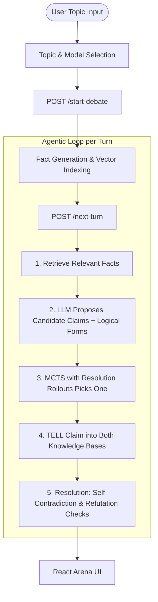

# ⚔️ Agentic Debate Arena with MCTS & Neuro-Symbolic Logic Verification

[](https://www.python.org/downloads/)
[](https://fastapi.tiangolo.com/)
[](https://reactjs.org/)
[](https://vitejs.dev/)
[](backend/tests/)

An autonomous **Neuro-Symbolic Agentic Debate System** where two AI debater agents argue opposite sides of any topic. LLMs (**Groq LPU**, **OpenRouter**, **Google Gemini**, **NVIDIA NIM**) propose the arguments; **Monte Carlo Tree Search (MCTS)** decides which one is spoken, and **propositional resolution** proves every refutation and self-contradiction. The language model writes, the algorithms decide.

---

## 🌟 Key Features

- ⚖️ **Explicit Sides:** Any topic — including choices like *"Gaming laptop or business laptop?"* — is first framed into a resolution with a stated position for each agent, shown in the arena header and enforced in every prompt.
- 📚 **Generated Fact Base:** At debate start an LLM generates ~20 facts about the topic, each with a propositional form (`A`, `¬A`, `A → B`) and a side. The facts seed each agent's knowledge base by side, and their atoms become the shared logical vocabulary of the debate. Nothing is pre-scripted per topic.
- 🤖 **Plan, Then Argue:** Each turn the speaking agent reads the exchange so far, plans, and proposes ~4 candidates — rebuttals of the last claim or arguments on an issue not yet debated — each labelled with its issue and side and carrying a propositional form. Candidates that help the other side are discarded. The LLM never picks the move or judges a contradiction.
- 🌳 **Monte Carlo Tree Search (MCTS):** UCB1 ($W_i / N_i + C \cdot \sqrt{\ln N_p / N_i}$) over the candidates, 32 simulations per turn, with resolution rollouts: a candidate scores for refuting something the opponent actually said and for opening a new issue, and loses for contradicting itself, repeating itself, re-arguing a worn-out point, or leaving an opening that a randomly sampled opponent reply could exploit.
- ⚡ **Propositional Resolution Engine:** Robinson resolution refutation ($\frac{A \lor B, \neg A}{B}$) checks every claim against the speaker's own KB (self-contradiction) and the opponent's KB (refutation). The verdict is the net count of proven refutations minus self-contradictions.
- 🔎 **Semantic Retrieval:** Cosine-similarity search over a hashed bag-of-words index of the fact base grounds each turn in the evidence most relevant to the opponent's last claim.
- 🔌 **Multi-Provider LLMs:** Groq LPU (`openai/gpt-oss-120b`, `openai/gpt-oss-20b`, `qwen/qwen3.8-27b`), OpenRouter (DeepSeek V3.2 / R1, Llama 3.3 70B, Qwen 2.5 72B), Google Gemini, and NVIDIA NIM, with per-provider model fallbacks. If the LLM fails mid-debate, candidates come from the agent's side of the generated fact base and the turn is visibly marked `fallback`.
- 🎨 **Arena UI:** Three themes with their own typography — *Brief* (printed legal brief), *Ledger* (Swiss editorial) and *Nocturne* (dark) — switched with a circular reveal. A live scoreboard tracks proven refutations; each refutation links to and draws an arc to the turn it refutes; every turn's MCTS candidates and scores can be expanded.

---

## 🏗️ Architecture



---

## 🚀 Quick Start (Single Command)

1. **Clone the repository:**
   ```bash
   git clone https://github.com/AdhithyaSivaraj/Agentic-Debate-Prep-Arena-Using-MCTS.git
   cd Agentic-Debate-Prep-Arena-Using-MCTS
   ```

2. **Install dependencies:**
   ```bash
   python -m venv .venv && source .venv/bin/activate
   pip install -r backend/requirements.txt
   (cd frontend && npm install)
   ```

3. **Configure API Keys:**
   Create a `backend/.env` file. The default models need **Groq** (Proposer, fact base) and **OpenRouter** (Opponent); the others are optional:
   ```env
   GROQ_API_KEY=gsk_...
   OPENROUTER_API_KEY=sk-or-...
   GEMINI_API_KEY=...
   NVIDIA_API_KEY=nvapi-...
   ```

4. **Launch Application:**
   Run the unified launcher script:
   ```bash
   ./run_app.sh
   ```

- **Frontend UI:** [http://localhost:5173](http://localhost:5173)
- **Backend API:** [http://localhost:8000](http://localhost:8000)
- **Swagger Docs:** [http://localhost:8000/docs](http://localhost:8000/docs)

---

## 🧪 Running Tests

The backend test suite covers MCTS, resolution theorem proving, retrieval, the tool executor, and the API endpoints. LLM calls are replaced by a deterministic fake (`tests/conftest.py`), so the suite runs offline in about a second:

```bash
source .venv/bin/activate
cd backend
pytest -v
```

---

## 📁 Repository Structure

```
.
├── backend/
│   ├── app/
│   │   ├── agents/          # DebaterAgent — the per-turn agentic loop
│   │   ├── api/             # FastAPI route handlers (/start-debate, /next-turn, /summary)
│   │   ├── core/            # MCTS, Resolution Engine, Retrieval & Knowledge Base
│   │   ├── models/          # Pydantic schemas
│   │   ├── tools/           # Tool executor dispatching to the core algorithms
│   │   └── llm_client.py    # Provider routing, fallbacks, JSON parsing
│   ├── tests/               # 223 unit & integration tests (offline, fake LLM)
│   └── requirements.txt
├── frontend/
│   ├── src/
│   │   ├── components/      # DebateArena, TopicSetup, verdict modal, loading overlay, StatusRing
│   │   ├── lib/             # API client, model list & theme switching
│   │   └── styles/          # Brief / Ledger / Nocturne themes
│   └── package.json
└── run_app.sh               # Unified bash launcher for backend + frontend
```

---

## 📄 Documents

- [Project report (PDF)](Project_Report_Agentic_Debate_Arena_Updated.pdf) — design, modules, case study and testing
- [Project presentation (PPTX)](Agentic_Debate_Arena.pptx)

---

## 🛡️ License

MIT License. Developed for advanced agentic AI research & debate logic verification.
